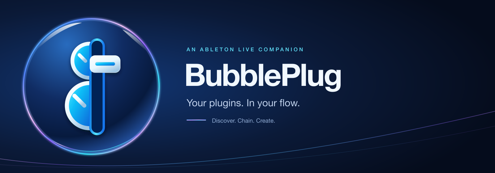

# BubblePlug

BubblePlug is a native macOS companion for Ableton Live. It searches Live's VST3
catalog, organizes plugins locally, and asks Live to load them on the selected
track. The interface is in English; project notes are in Portuguese.

The app uses a midnight-blue theme with cyan accents and subtle iridescent
borders, inspired by its soap-bubble logo. The library, chain builder, mixer,
settings and category editor share the same palette. Branding assets and the
editable SVG are in [docs/branding](docs/branding/README.md).

The technical project name remains **PlugSpot** for existing launcher, Remote
Script, bundle identifier and user-data compatibility.

## Current state

Implemented: VST3 catalog and search, provisional channel-variant grouping,
Favorites, Recent, editable color categories, Vendors, Cards/List, local plugin
artwork, a temporary chain queue, the floating bubble and its settings, and
Ableton Collections import/export. Mixer view can display a Live Set and save
recovery snapshots outside Live; saved snapshots can be selected and viewed
offline.

The mixer snapshot listener and offline recovery flow have not yet been checked
against a real Live Set. Plugin safety validation was removed at the user's
request; loading a faulty plugin can still crash Live. Complete plugin-internal
state such as a Kontakt library/instrument is not guaranteed to be available in
the snapshot.

## Requirements

- macOS 13 or later;
- Ableton Live 12.4.2 as the tested baseline; later 12.4 patches are accepted
  with a compatibility warning in the app;
- PlugSpot Remote Script installed as a Live Control Surface;
- VST3 plugins indexed by Live.

This working copy builds an **x86_64** app for the Intel development Mac. An
Apple Silicon or Universal build, signing, notarization, and a distributable
installer are still pending.

## Build and install

```sh
./macos/build-app.sh
./macos/install-launcher.sh
```

The installer copies the Remote Script to the default Ableton User Library and
configures the local launcher. Restart Live after updating the Remote Script.
In Live, select **PlugSpot** under **Settings → Link, Tempo & MIDI → Control
Surface** if it is not already selected.

The app can also be started from `build/PlugSpot.app` after Live has crashed to
inspect existing mixer snapshots. They are stored in
`~/Library/Application Support/PlugSpot/MixerSnapshots`.

## Use

- Single-click a plugin card to add it to the temporary chain queue.
- Double-click to send that plugin to the selected Live track.
- Use the queue controls to reorder/remove entries and load the chain.
- Use the **Mixer** button to view tracks and inspect recovery snapshots.
- Favorites, categories, recent loads, and library backups are local.

## Known gaps before a release

- Verify mixer change listeners, snapshot writes and offline recovery with real
  Live Sets, including a Live crash/restart.
- Verify bubble behavior, keyboard focus, and Live lifecycle on the reference
  Mac; gather the real CPU/RAM measurements reserved for the GitHub report.
- Generalize VST2/VST3/CLAP/AU classification and plugin-family variant
  grouping; the current catalog is VST3-only and grouping is provisional.
- Reconcile the six-category color mapping with unrestricted local categories;
  free-form user tags and removal of obsolete imported labels also remain open.
- Verify the destructive Ableton Collections export end to end.
- Finish Intel/Apple Silicon packaging, choose a license, and decide signing and
  notarization.

See [PlugSpot_PROJECT_PLAN.md](PlugSpot_PROJECT_PLAN.md) for the implementation
audit and ordered remaining work. Architecture, development notes, and the
implemented IPC contract are in [docs/ARCHITECTURE.md](docs/ARCHITECTURE.md),
[docs/DEVELOPMENT.md](docs/DEVELOPMENT.md), and [docs/PROTOCOL.md](docs/PROTOCOL.md).
