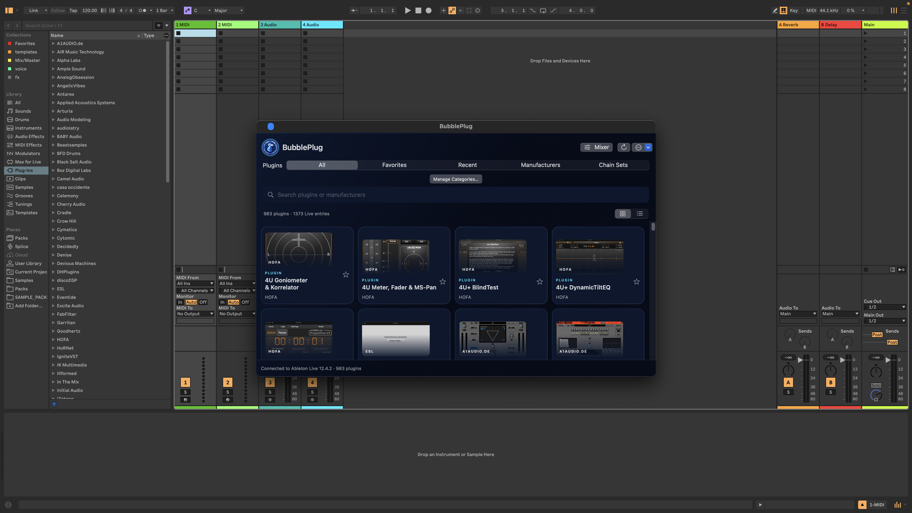
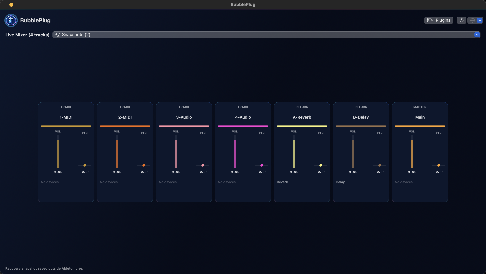

# BubblePlug

BubblePlug is a native macOS companion for Ableton Live. It searches Live's VST3
catalog, organizes plugins locally, and asks Live to load them on the selected
track. The interface and project documentation are in English.

> **Pre-release software:** BubblePlug is still being tested. There is no signed
> public installer yet. The current package is intended for local testing, not
> for a production installation.

**[Installation and setup](docs/USER_GUIDE.md#install-from-source)** ·
**[User guide](docs/USER_GUIDE.md)** ·
**[Changelog](CHANGELOG.md)** ·
**[Roadmap](ROADMAP.md)** ·
**[License](LICENSE)** ·
**[Report a bug](https://github.com/filipenvia/BubblePlug/issues/new?template=bug_report.yml)**

The app uses a midnight-blue theme with cyan accents and subtle iridescent
borders, inspired by its soap-bubble logo. The library, chain builder, mixer,
settings and category editor share the same palette. Branding assets and the
editable SVG are in [docs/branding](docs/branding/README.md).

Local settings and artwork are stored under BubblePlug-specific names. A build
with a new macOS app identity may need Screen Recording permission granted again.

See the [user guide](docs/USER_GUIDE.md), [changelog](CHANGELOG.md), and
[roadmap](ROADMAP.md) for setup, current limitations and planned work.

## What BubblePlug does

- Finds VST3 plugins already indexed by Ableton Live and browses them by name,
  manufacturer, favorites and local categories.
- Uses one click to add a plugin to a temporary chain and a double-click to
  insert it on Live's selected track.
- Saves Chain Sets locally and exports supported chains as Ableton `.adg` racks.
- Provides a floating bubble, a Live mixer view and recovery snapshots stored
  outside the Live Set.
- Prepares plugin artwork locally. Artwork is not uploaded to a shared service.

## Screenshots

These screenshots show BubblePlug connected to a blank Ableton Live 12.4.2 set.







See [branding assets](docs/branding/README.md) for the logo and GitHub banner.

## Current state

Implemented: VST3 catalog and search, provisional channel-variant grouping,
Favorites, Recent, editable color categories, Manufacturers, Cards/List, partial local plugin
artwork, a temporary chain queue and saved Chain Sets, the floating bubble and its settings, and
Ableton Collections import/export. Mixer view can display a Live Set and save
recovery snapshots outside Live; saved snapshots can be selected and viewed
offline.

The app's manual Ableton workflows have been exercised with a large Live Set.
Plugin safety validation was removed at the user's request; loading a faulty
plugin can still crash Live. Complete plugin-internal state such as a Kontakt
library/instrument is not guaranteed to be available in a recovery snapshot.

Plugin artwork uses exact VST3 snapshots and clearly named local image files.
On first setup, BubblePlug offers to prepare missing VST3 images or open without
them. By default, launch and catalog refresh do not open plugin editors. The
first-launch choice is remembered: **Load Missing Images** enables automatic
capture at startup, while **Open Without Loading** suppresses the prompt. Change
this later in **Settings → Plugin Images** or choose **Load Missing Images** in
the main menu to enable it and start now. **Capture Missing Images Once** in
Settings runs a one-time incremental scan without changing the preference; images
already in the library are retained and only unresolved plugins are searched or
captured. The bundled helper
opens editors one at a time, captures them with BubblePlug's Screen Recording
permission, and caches thumbnails without adding tracks to Live. Images can also
be assigned in **Manage Plugin Images**.

Artwork is central to BubblePlug, but local coverage depends on the user's
installed plugins. Inactive, damaged or incompletely installed plugins may not
produce a usable image, so zero missing images on every user's Mac is not a
release requirement. BubblePlug must identify unresolved items, preserve valid
images, allow manual assignment/retry, and avoid repeated full scans during
ordinary use.

## macOS privacy prompts during image capture

On the development Mac, macOS displayed requests for Calendar, Contacts,
Documents, Desktop and removable-volume access while plugin editors were being
captured. BubblePlug's own code does not request Calendar or Contacts access or
browse those personal folders. The image helper loads third-party VST3 code
inside BubblePlug's app identity, so a plug-in or its vendor framework may
trigger a macOS prompt that is labelled **BubblePlug**. These permissions are
not requirements for BubblePlug's library, mixer or Ableton integration. Only
Screen Recording is needed for image capture. Users can deny unexpected access;
that may limit the requesting plug-in's own feature, but is not needed for
BubblePlug itself. If a prompt appears, noting the plug-in currently being
captured will help identify its source.

## Requirements

- macOS 13 or later;
- Ableton Live 12.4.2 as the tested baseline; later 12.4 patches are accepted
  with a compatibility warning in the app;
- BubblePlug Remote Script installed as a Live Control Surface;
- VST3 plugins indexed by Live.

## Build and install

Building from source requires the macOS Command Line Tools or Xcode, Git, and
CMake. The build script downloads the pinned Steinberg VST3 SDK on its first
run. A working internet connection is needed for that initial build.

```sh
git clone https://github.com/filipenvia/BubblePlug.git
cd BubblePlug
./macos/build-pkg.sh
open build/BubblePlug-0.1.0.pkg
```

The package is **unsigned and not notarized**. macOS may block it or show a
security warning. Signing and notarization are not planned for the first
distribution. Follow the [full installation and setup guide](docs/USER_GUIDE.md)
for Ableton configuration, first launch, artwork permissions and troubleshooting.

To build without creating the installer, run `./macos/build-app.sh`. The default
build is Universal (`x86_64` + `arm64`). Apple Silicon runtime feedback is
welcome, but unavailable hardware does not block the initial release. See
[development setup](docs/DEVELOPMENT.md) before changing the code.

The build script supports **x86_64**, **arm64**, and **Universal** app bundles.
The default build cross-compiles both architectures into `build/BubblePlug.app`;
single-architecture builds are written to `build/BubblePlug-x86_64.app` or
`build/BubblePlug-arm64.app`. The `arm64` slice can be compiled on the Intel
development Mac, but it has not been run on Apple Silicon hardware. The
package is unsigned and not notarized; signing and notarization are outside the
initial distribution plan.

## Local build and Ableton integration setup

```sh
./macos/build-app.sh
./macos/build-app.sh x86_64
./macos/build-app.sh arm64
./macos/build-pkg.sh
./macos/install-launcher.sh
```

The no-argument build produces the Universal app. Use `x86_64` or `arm64` to
build one architecture for diagnosis.

In Live, select **BubblePlug** under **Settings → Link, Tempo & MIDI → Control
Surface** if it is not already selected.

`build-pkg.sh` creates `build/BubblePlug-0.1.0.pkg`. The package installs the
Universal app to `/Applications/BubblePlug.app`, copies the BubblePlug Remote
Script into the logged-in user's default Ableton User Library, and configures
the lifecycle launcher and export worker. Restart Live after installation so
it loads the Control Surface. The package is unsigned for public distribution
and is currently intended for local clean-install testing.

`install-launcher.sh` remains available for development checkouts; it installs
the Remote Script and launcher against `build/BubblePlug.app`.

The app can also be started from `build/BubblePlug.app` after Live has crashed to
inspect existing mixer snapshots. They are stored in
`~/Library/Application Support/BubblePlug/MixerSnapshots`.

## Use

- Single-click a plugin card to add it to the temporary chain queue.
- Double-click to send that plugin to the selected Live track.
- Use the queue controls to reorder/remove entries and load the chain.
- Use the **Mixer** button to view tracks and inspect recovery snapshots.
- Favorites, categories, recent loads, and library backups are local.

## Known gaps before a release

- Package installation, upgrade, reinstall, and manual removal have passed on
  the reference account; its user library and snapshots remained intact. A
  separate clean macOS account and custom Ableton User Library path are still
  untested. The installer uses the default path and no dedicated uninstaller
  exists yet. See the [QA record](docs/RELEASE_QA_CHECKLIST.md).

The screenshot-based setup and usage guide is in
[docs/USER_GUIDE.md](docs/USER_GUIDE.md). Manual Ableton workflows and
performance measurements are complete; see the [QA record](docs/RELEASE_QA_CHECKLIST.md).

## Scope and optional feedback

- Generalize VST2/VST3/CLAP/AU classification and plugin-family variant
  grouping; the current catalog is VST3-only and grouping is provisional.
- The first release supports up to six local categories, matching Ableton's
  Collection colors. Free-form user tags are not currently planned.
- Chain Sets can be saved locally, renamed, removed, and loaded back into the
  chain queue. Clicking a set expands its ordered plugins in place; its chain
  can be edited and saved again. Chain Sets can also be exported as Ableton
  `.adg` racks. Export currently supports serial audio-effect chains and an
  instrument followed by audio effects. MIDI-effect racks, multiple serial
  instruments, and private plugin preset/state are not supported. The user has
  confirmed that `.adg` export works in Live for supported chain types.
- The Universal app's arm64 slice has not been runtime-tested on Apple Silicon.
  Volunteer feedback is welcome but not a release blocker. Apple signing and
  notarization are not planned for the initial distribution.

## Optional Apple Silicon feedback

BubblePlug can be built as a Universal app, but the `arm64` build has not
been run on Apple Silicon hardware by the maintainers. Feedback is welcome but
not required for the initial release. If you try it, please report your Mac
chip, macOS version, Ableton Live version, whether the app
starts and connects, and which plugin loading or mixer flows you exercised.
Please include reproduction steps for failures and remove personal paths or
other private information from logs. Use the
[Apple Silicon feedback issue template](.github/ISSUE_TEMPLATE/apple-silicon-feedback.md).

See [BubblePlug_PROJECT_PLAN.md](BubblePlug_PROJECT_PLAN.md) for the implementation
audit and ordered remaining work. Architecture, development notes, and the
implemented IPC contract are in [docs/ARCHITECTURE.md](docs/ARCHITECTURE.md),
[docs/DEVELOPMENT.md](docs/DEVELOPMENT.md), and [docs/PROTOCOL.md](docs/PROTOCOL.md).

## Contributing and support

BubblePlug's original code is available under the MIT License. The bundled
Steinberg SDK and third-party plugin artwork have separate rights; see
[third-party notices](THIRD_PARTY_NOTICES.md). Use the issue forms to report
reproducible bugs or propose features. Include macOS version, Mac architecture,
Ableton Live version and steps to reproduce. Remove project names, personal
paths, credentials and other private information from screenshots and logs.
Permission prompts that appear while a plugin is opening should include the
plugin name; third-party plugin code may trigger prompts labelled BubblePlug.
