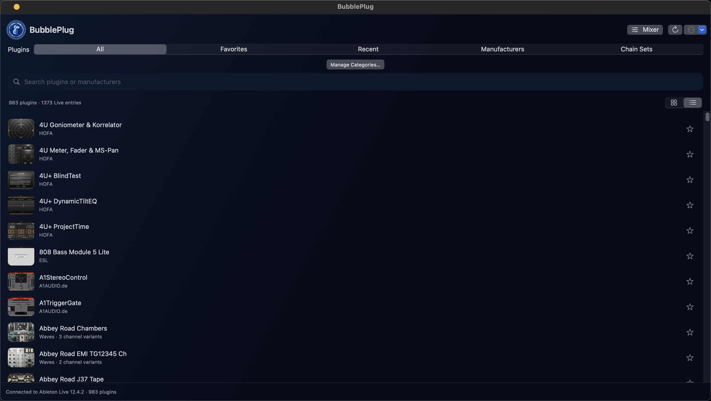
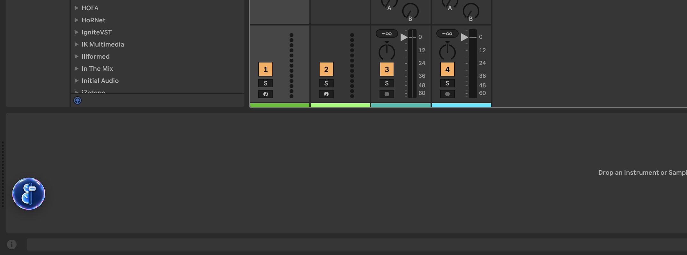
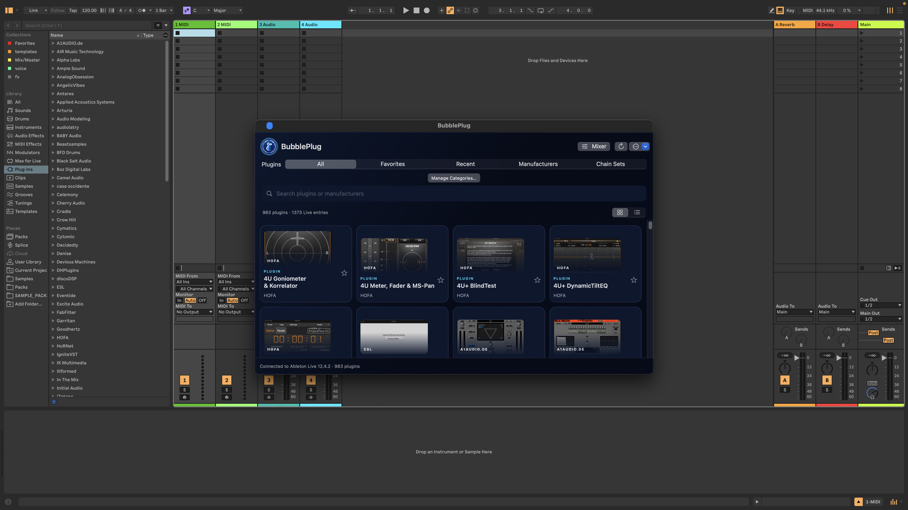
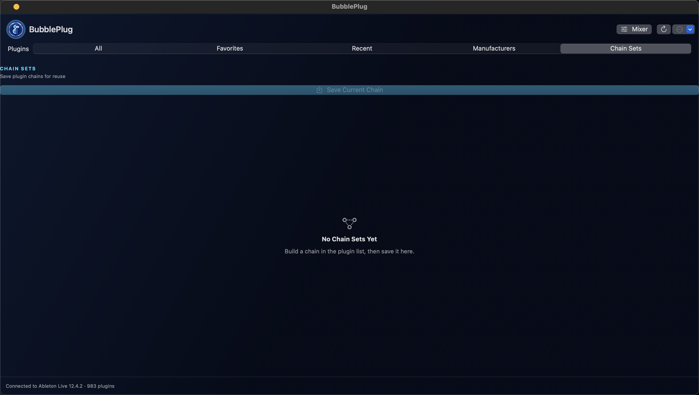
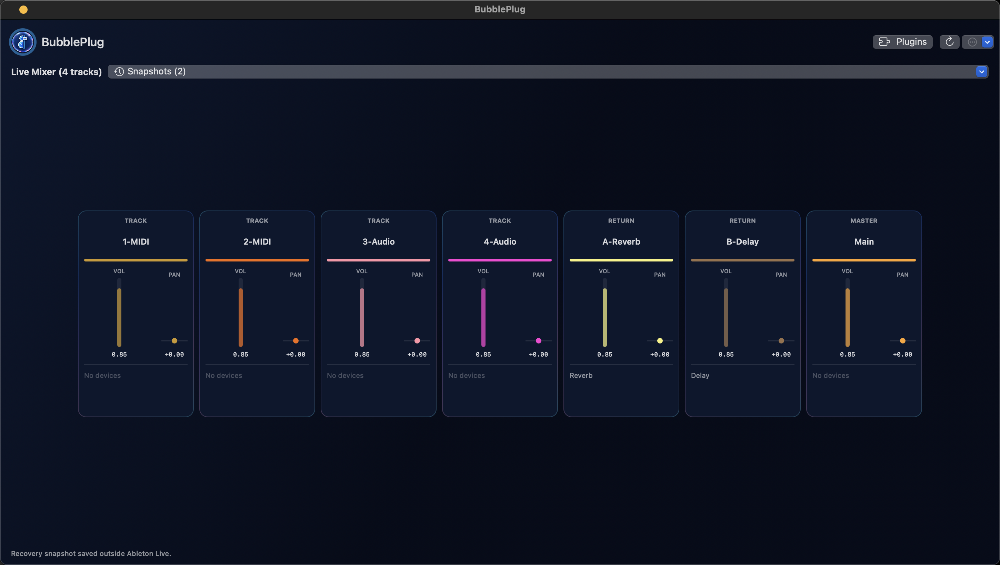

# BubblePlug user guide

BubblePlug is a macOS companion for Ableton Live. It uses Live's BubblePlug
Control Surface script to browse Live's VST3 catalog, request plugin insertion,
and read mixer information.

This guide covers installing the current unsigned test package, connecting to
Live, preparing plugin artwork, building chains, and using the Mixer. The
screenshots show a clean Live Set and contain no personal project names or
paths.

## Contents

- [Requirements](#requirements)
- [Install from source](#install-from-source)
- [Connect BubblePlug to Live](#connect-bubbleplug-to-live)
- [First launch and plugin artwork](#first-launch-and-plugin-artwork)
- [Browse and load plugins](#browse-and-load-plugins)
- [Chain Sets](#chain-sets)
- [Mixer and recovery snapshots](#mixer-and-recovery-snapshots)
- [Permissions and privacy](#permissions-and-privacy)
- [Troubleshooting](#troubleshooting)

## Requirements

- macOS 13 or later.
- Ableton Live 12.4.2 is the tested baseline; compatibility with other versions
  has not been established.
- VST3 plugins indexed by Live.
- The BubblePlug Control Surface installed and selected in Live.

## Install from source

There is no signed or notarized public installer yet. The package built from
this repository is an unsigned test package. Building it requires macOS Command
Line Tools or Xcode, Git, CMake, and an internet connection on the first build
so the pinned Steinberg VST3 SDK can be downloaded. These tools are needed only
to build BubblePlug; they are not runtime dependencies of an already-built app.

1. Clone or download the repository from
   [GitHub](https://github.com/filipenvia/BubblePlug).
2. Open Terminal and change to the repository directory.
3. Build the app and installer package:

   ```sh
   ./macos/build-pkg.sh
   ```

4. Open `build/BubblePlug-0.1.0.pkg` and follow the Installer steps. It installs
   BubblePlug in `/Applications` and the BubblePlug Control Surface in the default
   Ableton User Library location.
5. Open Live and go to **Settings → Link, Tempo & MIDI**. In a free Control
   Surface row, choose **BubblePlug**. Select the matching **BubblePlug** input and
   output ports if Live does not select them automatically.
6. Restart Live so it loads the Control Surface and starts BubblePlug.

When upgrading from an earlier build, the installer migrates BubblePlug's local
library, artwork, and launcher files, then replaces the old Control Surface
folder. After installation, select **BubblePlug** in Live's Control Surface
menu once and restart Live.

The package is unsigned and not notarized, so macOS may block it. Only bypass
this warning if you built the package yourself or verified that it came from
the official BubblePlug repository. After attempting to open a trusted package,
open **System Settings → Privacy & Security**, scroll to **Security**, and
choose **Open Anyway** for BubblePlug, then confirm. Do not disable Gatekeeper
globally. See [Apple's instructions](https://support.apple.com/102445) for the
current per-app override flow.

The package currently installs the Control Surface to the default path
`~/Music/Ableton/User Library/Remote Scripts/BubblePlug`. If Live uses a custom
User Library location, install/configure the Remote Script for that location
before selecting the Control Surface. Custom-location installation is not yet
automated by this package.

## Connect BubblePlug to Live

After restarting Live, BubblePlug should open in its floating bubble and show a
connected status. Click the bubble to open the full window. The bubble follows
Live and is intended to remain available over Live, including its fullscreen
Space; it hides when another app becomes active.



*The library shows Live's VST3 catalog, artwork, manufacturers, and favorites.
Search by plugin or manufacturer name.*





## First launch and plugin artwork

On first launch, BubblePlug offers to prepare plugin images or open without
them. By default, opening BubblePlug and refreshing the Live catalog do not
launch plugin editors. The first-launch choice is remembered: **Load Missing
Images** enables automatic capture at startup, while **Open Without Loading**
suppresses the prompt. Change this later in **Settings → Plugin Images** or
choose **Load Missing Images** in the main menu to enable it and start now.
**Capture Missing Images Once** in Settings runs an incremental scan without
changing the startup choice. Existing images are kept, and only unresolved
plugins are searched or captured.

When capture is enabled, the bundled helper opens unresolved VST3 editors one at
a time and captures their windows. It can take a while. An inactive, damaged,
unauthorized, or otherwise unavailable plugin may not produce usable artwork.
You can leave image preparation for later and keep using the rest of the app.
Assign or replace images manually in **Manage Plugin Images**. Images and the
plugin library stay local; this build does not upload artwork to a shared
service.

Screen Recording permission is required for live plugin-editor image capture.
If macOS asks for it, enable BubblePlug in **System Settings → Privacy &
Security → Screen Recording**, then quit and reopen BubblePlug if capture still
does not work. Refreshing the Live catalog does not start image capture.

## Browse and load plugins

- Search the VST3 catalog and browse **All**, **Favorites**, **Recent** or
  **Manufacturers**.
- Single-click a plugin to add it to the temporary chain queue.
- Double-click a plugin to request insertion on Live's selected track.
- Reorder or remove queued plugins, then load the chain.

Live must be open and connected for insertion and mixer operations. BubblePlug
does not validate a plugin before loading it; a faulty plugin may crash Live.

## Chain Sets

Add plugins to the temporary queue, arrange them in order, then open **Chain
Sets** and save the current chain. Saved sets can be expanded to review their
plugins, edited, renamed, removed, or loaded back into the queue.



*The Chain Sets tab stores plugin chains locally for reuse.*

Supported chains can be exported as Ableton `.adg` racks. Export has been
confirmed in Live for supported chain types: serial audio effects and an
instrument followed by audio effects. MIDI-effect racks, multiple serial
instruments, and private plugin preset/state are not supported.

## Mixer and recovery snapshots

The Mixer view refreshes track, return, master, and device information from Live
and saves a recovery snapshot outside the Live Set. Open **Snapshots** to view
an earlier snapshot, including when Live is unavailable. Snapshots are a
recovery aid; they cannot restore private plugin state such as a Kontakt
instrument or library selection.



*The Mixer displays Live tracks, returns, and the master channel.*

## Permissions and privacy

BubblePlug itself does not use Contacts or Calendar. While a plugin is being
captured, the plugin or one of its vendor frameworks may ask for Calendar,
Contacts, Documents, Desktop, or removable-volume access. Because the bundled
image helper hosts third-party plugin code, macOS may label the request
**BubblePlug**. These permissions are not requirements for BubblePlug's
library, mixer, or Ableton integration. You can deny unexpected requests; that
may limit a feature of the plugin that requested access.

Favorites, categories, Chain Sets, artwork, and snapshots remain on the local
Mac. Before posting screenshots or logs to GitHub, remove Live Set names,
account names, personal paths, license keys, and other private information.
When reporting a permission prompt, include the plugin that was opening.

## Troubleshooting

- **BubblePlug does not connect:** confirm Live is running, BubblePlug is selected
  as a Control Surface, and Live has been restarted after installation.
- **No plugins appear:** confirm Live has indexed the VST3 plugins and refresh
  the BubblePlug library.
- **An image is missing or incorrect:** assign or replace it in **Manage Plugin
  Images**, or choose **Load Missing Images** to retry unresolved entries.
- **A plugin crashes Live:** restart Live and check that plugin's installation;
  BubblePlug does not run a safety validator before loading plugins.
- **The bubble or fullscreen behavior is wrong:** include macOS version, Live
  version, display arrangement, and steps to reproduce in a GitHub issue.
- **macOS blocks the unsigned package:** use the per-app **Open Anyway** flow
  described above only if you trust the package source. Do not disable Gatekeeper
  globally.

For support, use the [GitHub bug report form](https://github.com/filipenvia/BubblePlug/issues/new?template=bug_report.yml).
Include BubblePlug, macOS, Mac architecture, and Live versions, and steps to
reproduce. Sanitize screenshots and logs before attaching them.
